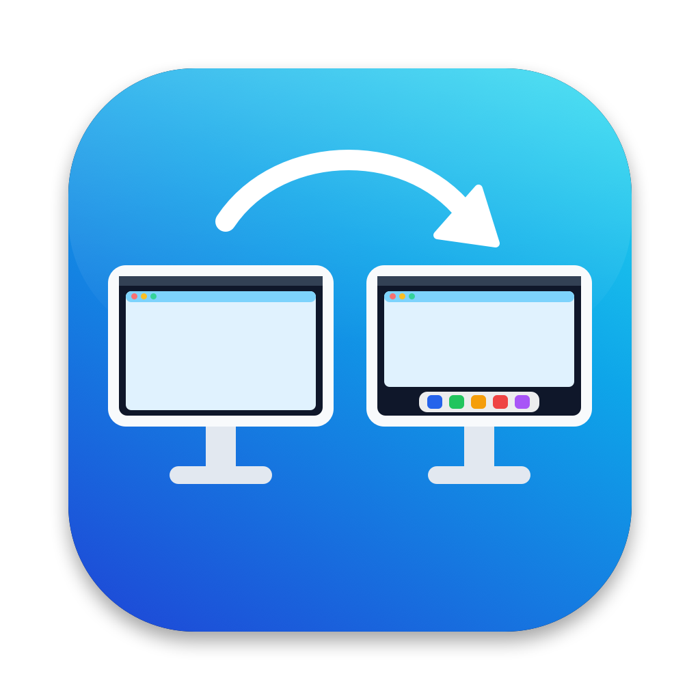

<p align="center">
  
</p>

<h1 align="center">Dynamic Dock Space</h1>

<p align="center">
  <b>Suas janelas acompanham a Dock entre monitores.</b><br>
  Um pequeno app de barra de menus para macOS que redimensiona as janelas quando a Dock muda de monitor.
</p>

<p align="center">
  <a href="https://youtube.com/shorts/EFAg826NqA4">▶️ Veja o vídeo de 36 segundos</a> ·
  <a href="https://github.com/ThePaladini/dynamic-dock-space/releases/latest">⬇️ Baixar</a> ·
  <a href="README.md">🇺🇸 Read in English</a>
</p>

---

## O problema

Com vários monitores (e *Monitores com Spaces separados* ligado, o padrão do macOS), a Dock pula para o monitor em que você encosta o cursor na borda inferior. O macOS atualiza a área útil de cada tela, mas **as janelas já abertas não reagem**:

- no monitor que **recebe** a Dock, as janelas maximizadas ficam **atrás** dela;
- no monitor que ela **deixou**, sobra uma faixa vazia onde a Dock ficava.

## O que o Dynamic Dock Space faz

| Quando a Dock… | As janelas daquele monitor… |
|---|---|
| **chega** | que invadem a Dock encolhem, mantendo a borda superior, ou sobem se estiverem baixas demais |
| **sai** | que estavam dimensionadas até a Dock crescem até a borda da tela (maximizadas, metades e terços, mantendo as margens) |
| **volta** | recuperam exatamente o tamanho anterior |

Funciona com a Dock original da Apple, sem substituir, alterar o visual ou recriar nada, e nunca usa a tela cheia do macOS.

- 🎞 **Redimensionamento animado e suave.** Quando a Dock está para chegar, as janelas encolhem *antes* de o macOS mudar a área útil, então os apps não as cortam de forma brusca.
- 🧠 **Respeita você.** Se você redimensionar ou mover uma janela depois do ajuste, a sua escolha vale. Nada acontece enquanto um botão do mouse estiver pressionado.
- 🙈 **Não mexe** em janelas minimizadas, em tela cheia, painéis, diálogos e apps excluídos.
- 🪶 **Leve.** Orientado a eventos, sem polling. Medido num M4 Pro: 0% de CPU quando você não está usando o computador, ~1% de um núcleo enquanto o mouse se move (para antecipar a Dock), ~35 ms de CPU por troca de Dock e ~25–45 MB de memória.
- 🌐 Inglês e português do Brasil (segue o idioma do sistema).

## Menu

- **Automação ativa** · **Somente com mais de um monitor**
- Monitor da Dock (borda, oculta, tamanho reservado) e lista de monitores
- **Ajustar janelas agora**
- **Janelas ajustadas**
  - *Somente as que ocupam toda a área útil*: só janelas maximizadas ou "preencher"
  - *Maximizadas e encostadas na Dock* (padrão): também metades e terços lado a lado
  - *Também janelas movidas que alcançam a área da Dock*: também janelas que você arrastou um pouco para baixo
- **Expandir janelas em telas sem Dock** · **Animar redimensionamento**
- **Aplicativos ignorados**: ignorar o app em primeiro plano ou escolher entre os apps em execução
- **Iniciar junto com o macOS**

## Instalação

### Download

1. Baixe `DynamicDockSpace.zip` da [última versão](https://github.com/ThePaladini/dynamic-dock-space/releases/latest) e mova o **DynamicDockSpace.app** para `/Applications` ou `~/Applications`.
2. O app é de código aberto, mas não é autenticado pela Apple, então a primeira abertura é bloqueada. Abra uma vez e depois vá em **Ajustes do Sistema › Privacidade e Segurança › Abrir Mesmo Assim**. (Ou rode `xattr -dr com.apple.quarantine /Applications/DynamicDockSpace.app`.)
3. Conceda a permissão de **Acessibilidade** quando pedida (Ajustes do Sistema › Privacidade e Segurança › Acessibilidade). O app detecta sozinho.

> **Depois de atualizar** para um build novo, o macOS pode continuar mostrando o app como permitido mas ignorá-lo, porque a permissão é vinculada ao binário exato. Remova o app da lista de Acessibilidade com **–** e adicione de novo.

### Compilar o código

Requer macOS 13+ e as Command Line Tools (`xcode-select --install`). Não precisa do Xcode.

```sh
git clone https://github.com/ThePaladini/dynamic-dock-space.git
cd dynamic-dock-space
./build.sh --install     # build universal (Apple Silicon + Intel), copiado para ~/Applications
```

`./build.sh --zip` gera o zip para distribuição.

## Linha de comando

```sh
APP=~/Applications/DynamicDockSpace.app/Contents/MacOS/DynamicDockSpace
$APP --status                     # o que foi detectado (telas, Dock, AXList) e sai
$APP --verbose --dry-run          # mostra o que faria, sem alterar nenhuma janela
$APP --verbose --only "Safari"    # age apenas em um app                       (testes)
$APP --verbose --only-title Foo   # age apenas em janelas com *Foo* no título  (testes)
```

## Como funciona

A investigação, as medições e as decisões técnicas estão detalhadas no [README em inglês](README.md#how-it-works). Em resumo:

- `NSScreen.visibleFrame` **acompanha** a Dock em tempo real (~200 ms).
- A Dock **oculta** é localizada pelo `AXList` dela, que continua existindo logo além da borda da tela.
- Cada evento gera uma reconciliação idempotente via API de Acessibilidade, com registros de *antes/depois* para restaurar os tamanhos exatos.
- O app antecipa a chegada da Dock (~200 ms) para animar o encolhimento antes de os apps cortarem as janelas por conta própria.
- Há tratamento específico para as particularidades do Chromium e do Electron (Chrome, VS Code, Slack…).

## Licença

[MIT](LICENSE) © 2026 ThePaladini
